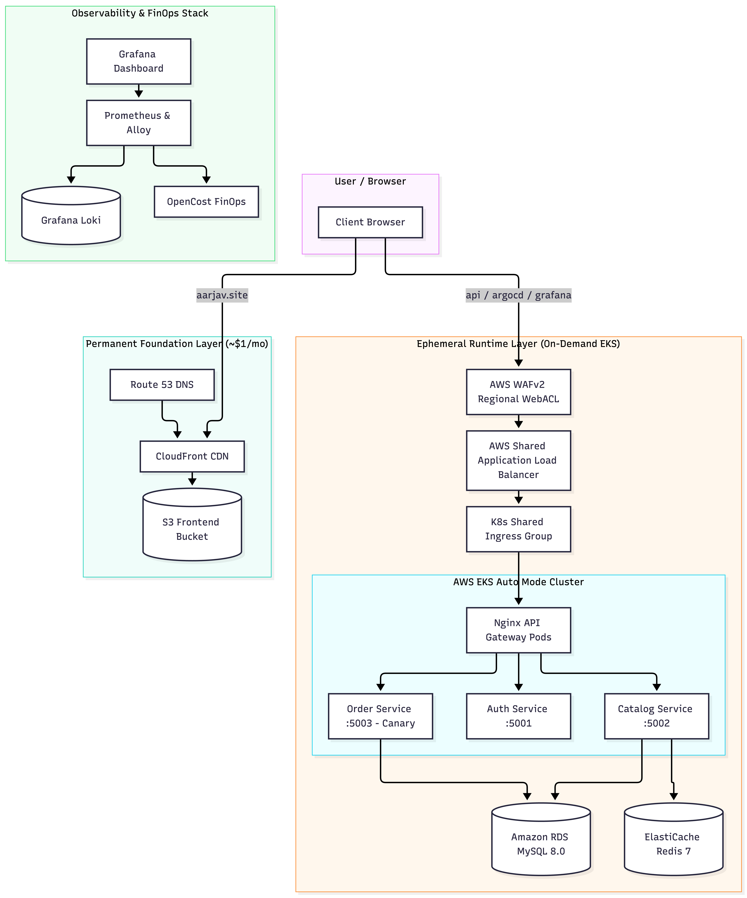
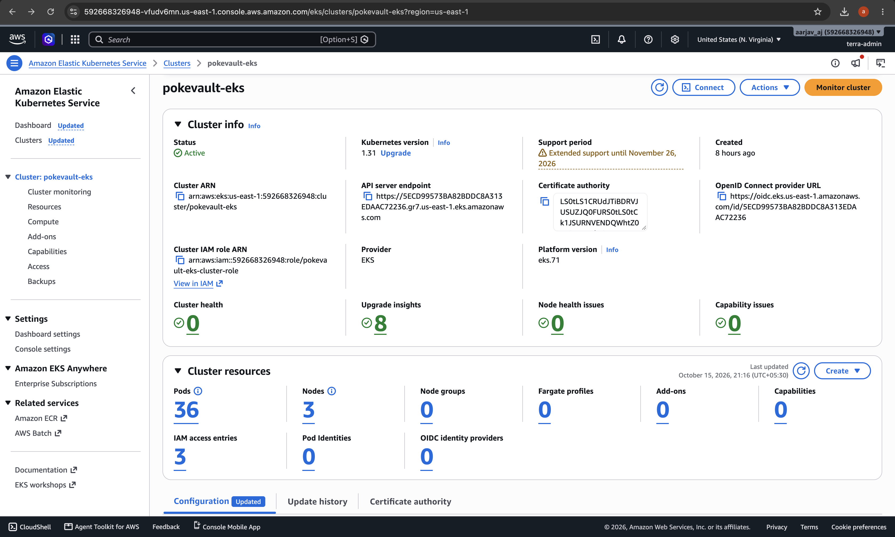
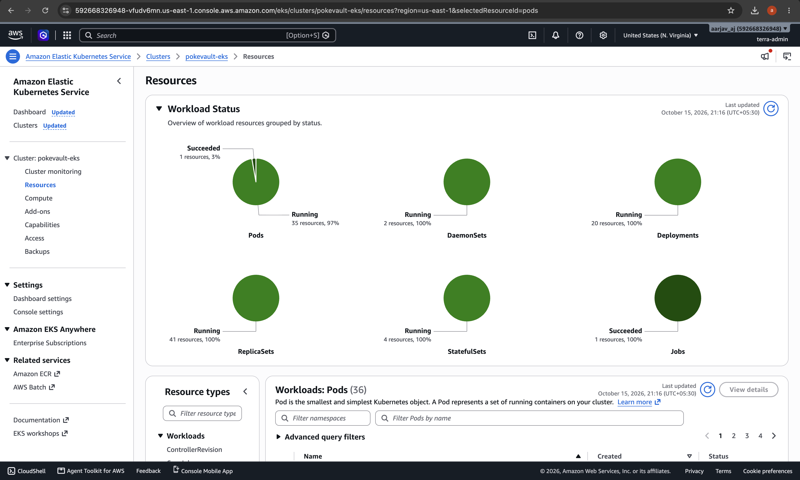
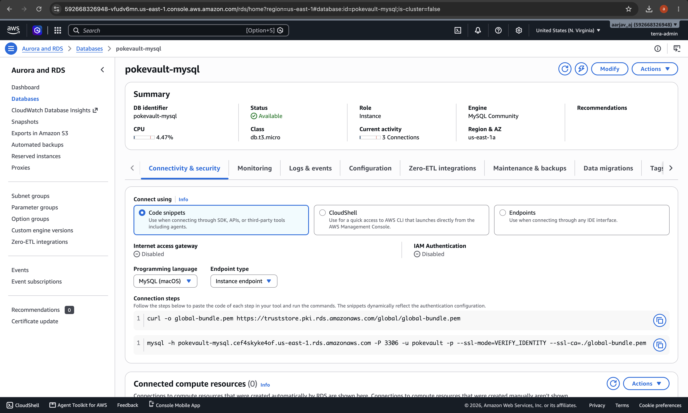
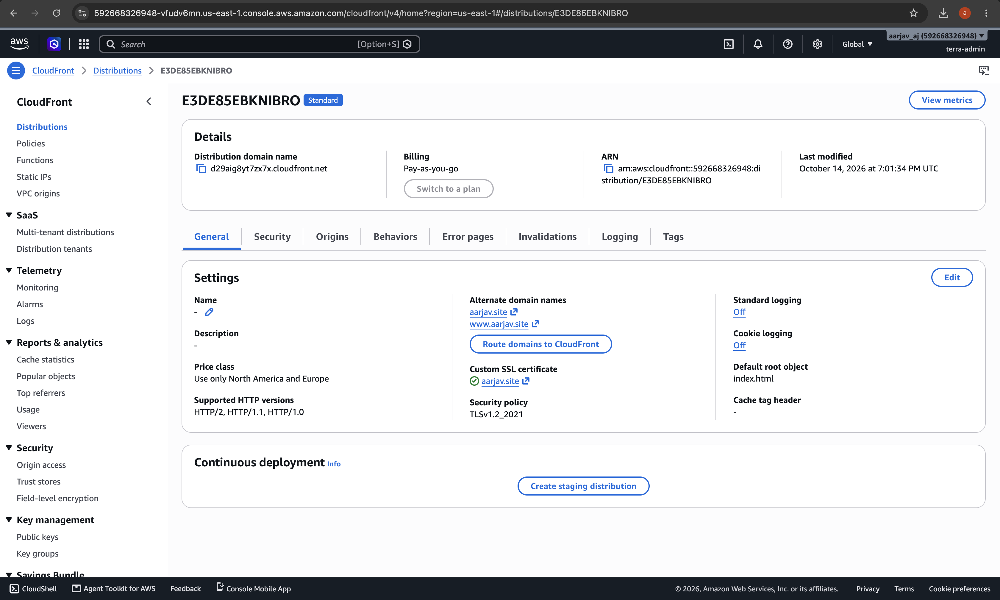
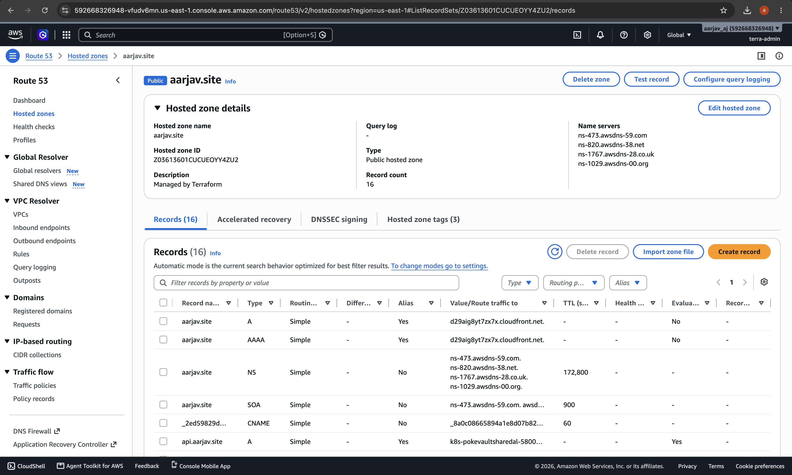
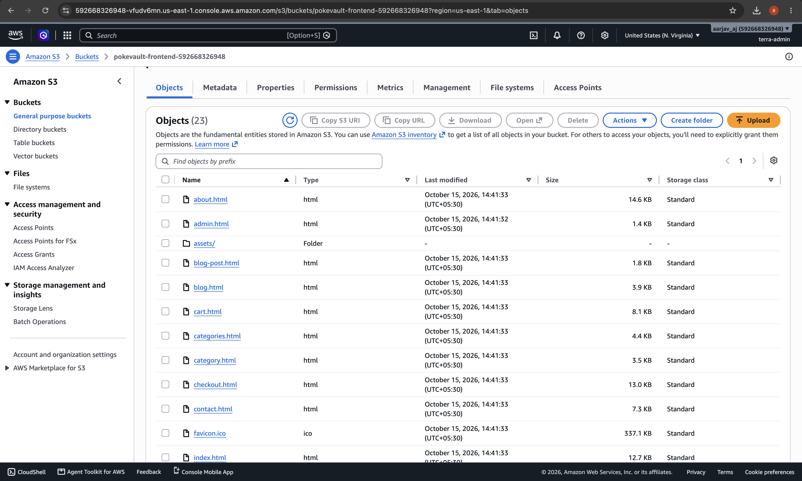
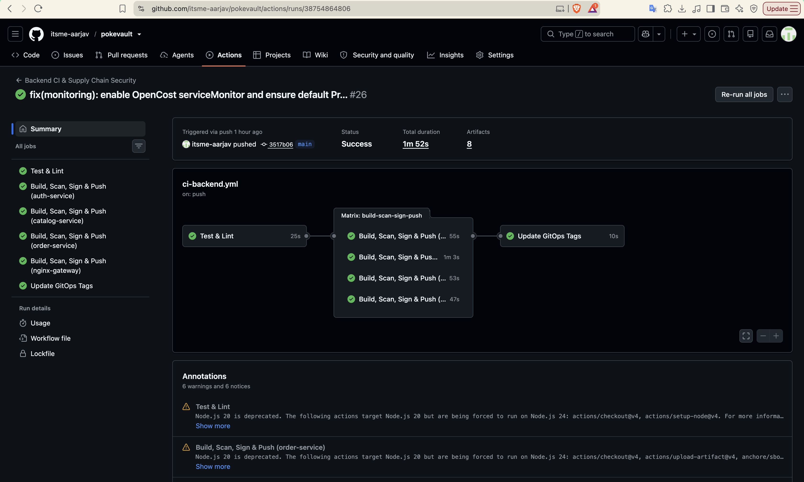

<div align="center">

# ⚡ PokéVault Legends
### Enterprise-Grade, Cost-Optimized Cloud-Native E-Commerce Platform on AWS

[](https://aws.amazon.com/)
[](https://aws.amazon.com/eks/)
[](https://www.terraform.io/)
[](https://argoproj.github.io/cd/)
[](https://argoproj.github.io/rollouts/)
[](https://prometheus.io/)
[](https://grafana.com/)
[](https://www.opencost.io/)
[](https://aws.amazon.com/waf/)
[](https://trivy.dev/)
[](https://sigstore.dev/)
[](LICENSE)

<br/>

**PokéVault Legends** is a state-of-the-art, production-grade cloud-native e-commerce ecosystem built with **Node.js microservices**, **Vite frontend**, and deployed on **Amazon Web Services (AWS)** using **EKS Auto Mode (v1.31)**, **Terraform**, **GitOps (Argo CD & Argo Rollouts Canary)**, and a **Two-Tier Cost-Optimized Cloud Architecture**.

---

### 🌐 Live Production Cloud Endpoints

| Service / Layer | Public Endpoint | Infrastructure Mapping | Security & Protocol |
| :--- | :--- | :--- | :--- |
| **Storefront (Frontend)** | [https://aarjav.site](https://aarjav.site) | Amazon CloudFront CDN + S3 Bucket (OAC) | TLS 1.2, Custom ACM Cert, Edge-Cached |
| **Alternate Storefront** | [https://www.aarjav.site](https://www.aarjav.site) | Route 53 Alias -> CloudFront | Automatic HTTPS Redirect |
| **API Gateway** | [https://api.aarjav.site](https://api.aarjav.site) | AWS Shared ALB -> Nginx Gateway -> Microservices | AWS WAFv2 Protected, Rate-Limited |
| **GitOps Dashboard** | [https://argocd.aarjav.site](https://argocd.aarjav.site) | AWS Shared ALB -> Argo CD Server | SSO / Token Auth, TLS Encrypted |
| **FinOps & Observability** | [https://grafana.aarjav.site](https://grafana.aarjav.site) | AWS Shared ALB -> Grafana Operator | OpenCost FinOps, Prometheus, Loki |

</div>

---

## 🎥 Platform Walkthrough & End-to-End Demo

https://github.com/user-attachments/assets/pokevault-demo

> [!NOTE]
> The full recorded demo is committed in [`screen-recordings/pokevault-demo.mp4`](screen-recordings/pokevault-demo.mp4), capturing live authentication, catalog browsing with Redis caching, order placement with progressive canary routing, Argo CD synchronizations, and OpenCost FinOps budget monitoring.

---

## 🏗️ System Architecture



---

## 💡 Key Architectural Innovations

### 1. Two-Tier Cost-Optimized Cloud Architecture
Unlike traditional enterprise cloud architectures that incur hundreds of dollars per month in idle resource waste, PokéVault implements a **Two-Tier Separation of Concerns**:

| Layer | Components | Monthly Cost | Lifecycle Strategy |
| :--- | :--- | :--- | :--- |
| **Tier 1: Permanent Foundation** | Route 53 Hosted Zone, ACM Wildcard Certs, CloudFront Distribution, S3 Frontend Bucket, ECR Registries, GitHub OIDC IAM Role | **~$1.00 / month** | **Always-On**: Domain ownership, DNS propagation, SSL certificates, and CI/CD trust are never destroyed. |
| **Tier 2: Ephemeral Runtime** | VPC, EKS Auto Mode Cluster (Karpenter compute, EBS CSI, ALB controller), RDS MySQL 8.0, ElastiCache Redis, WAF WebACL, 8 Helm Addons | **$0.00 / hour when destroyed** (~$0.25/hr live) | **On-Demand**: 100% spin up via `./scripts/deploy.sh` and 100% teardown via `./scripts/destroy.sh` with zero orphaned ENIs, volumes, or load balancers. |

### 2. Single Shared Application Load Balancer
Standard Kubernetes deployments provision a separate AWS Application Load Balancer per ingress, rapidly racking up costs (~$25/mo per ALB + LCU hours). PokéVault leverages AWS Load Balancer Controller's Ingress Grouping:
```yaml
alb.ingress.kubernetes.io/group.name: pokevault-shared-alb
alb.ingress.kubernetes.io/scheme: internet-facing
alb.ingress.kubernetes.io/target-type: ip
```
- A single ALB securely terminates TLS and multiplexes host routing for:
  - `api.aarjav.site` -> Nginx Gateway
  - `argocd.aarjav.site` -> Argo CD Web UI
  - `grafana.aarjav.site` -> Grafana Monitoring & FinOps
- **Savings**: Eliminates 2 redundant ALBs, cutting idle ingress overhead by **66%**.

### 3. Amazon EKS Auto Mode & Karpenter
PokéVault runs on the newest **AWS EKS Auto Mode (Kubernetes 1.31)**:
- **Zero Node Group Management**: Eliminates static EC2 Auto Scaling Groups; Karpenter automatically discovers pending pods and dynamically provisions right-sized Graviton / AMD compute (`c7i-flex.large`, `c6g.large`).
- **Managed In-Tree Addons**: Block storage (`aws-ebs-csi-driver`) and load balancing (`aws-load-balancer-controller`) are managed natively by the EKS control plane.

---

## 📦 Microservices & Tech Stack

```
pokevault/
├── services/
│   ├── auth-service/        # Node.js 20, Express, JWT, bcrypt password hashing
│   ├── catalog-service/     # Node.js 20, Express, MySQL connection pool, ElastiCache Redis caching
│   ├── order-service/       # Node.js 20, Express, MySQL transaction engine, Argo Rollouts canary target
│   └── nginx-gateway/       # Nginx Alpine reverse proxy, rate limiting, unified CORS, routing
├── frontend/                # Vite SPA, Vanilla CSS design tokens, Canvas Confetti, Three.js 3D cards
├── gitops/                  # Argo CD App-of-Apps root manifest & Helm charts
├── infra/
│   ├── foundation/          # Terraform: Route 53, ACM, CloudFront, S3, ECR, IAM OIDC
│   └── runtime/             # Terraform: VPC, EKS Auto Mode, RDS MySQL, ElastiCache Redis, WAF, Helm addons
└── scripts/                 # Idempotent deploy.sh, destroy.sh, bootstrap-state.sh
```

### Microservice Specifications

| Service | Port | Primary Responsibilities | Data Store / Dependencies |
| :--- | :--- | :--- | :--- |
| **`auth-service`** | `5001` | User registration, authentication, JWT token signing, bcrypt verification | Amazon RDS MySQL (`users` table) |
| **`catalog-service`** | `5002` | Item catalog lookup, category queries, stock validation, 60s cache-aside pattern | Amazon RDS MySQL + Amazon ElastiCache Redis |
| **`order-service`** | `5003` | Order creation, atomic stock decrements, history tracking, Canary progressive delivery | Amazon RDS MySQL (`orders`, `order_items`) |
| **`nginx-gateway`** | `8080` | Edge reverse proxy, URL rewriting (`/api/auth`, `/api/catalog`, `/api/orders`), rate limiting | Microservices internal mesh |

---

## 🚀 GitOps & Progressive Canary Delivery

PokéVault implements GitOps via **Argo CD** and continuous canary delivery via **Argo Rollouts**:

```
[Git Push to main] ──► [GitHub Actions CI] ──► [Cosign Sign & ECR Push] ──► [Update GitOps Repo]
                                                                                     │
                                                                                     ▼
[Argo CD Root App Auto-Reconcile] ◄──────────────────────────────────────────────────┘
         │
         ├──► [Deploy Auth Service & Catalog Service]
         └──► [Trigger Argo Rollout: Order Service]
                   │
                   ├──► Step 1: 20% Traffic to Canary ──► Prometheus Metric Analysis
                   ├──► Step 2: 50% Traffic to Canary ──► Automated Health Checks
                   └──► Step 3: 100% Traffic Promoted to Stable
```

### Canary Rollout Manifest (`order-service`)
```yaml
apiVersion: argoproj.io/v1alpha1
kind: Rollout
metadata:
  name: order-service
  namespace: pokevault
spec:
  replicas: 2
  strategy:
    canary:
      canaryService: order-service-canary
      stableService: order-service-stable
      trafficRouting:
        nginx:
          stableIngress: order-service-ingress
      steps:
        - setWeight: 20
        - pause: { duration: 60s }
        - setWeight: 50
        - pause: { duration: 60s }
```

---

## 🛡️ Enterprise Security & Supply Chain DevSecOps

```
┌─────────────────────────────────────────────────────────────────────────────┐
│                       ZERO-TRUST SUPPLY CHAIN PIPELINE                      │
├─────────────────┬────────────────────┬──────────────────┬───────────────────┤
│ 1. Code & Deps  │ 2. Docker Build    │ 3. Security Scan │ 4. Sign & Push    │
│                 │                    │                  │                   │
│ • ESLint & Test │ • Multi-Arch Build │ • Trivy Image    │ • Cosign Keyless  │
│ • Gitleaks Scan │ • linux/amd64      │   Vulnerability  │   Signing (OIDC)  │
│ • Zero Secrets  │ • Distroless/Alpine│ • High/Crit Gate │ • Push to AWS ECR │
└─────────────────┴────────────────────┴──────────────────┴───────────────────┘
```

1. **Edge Perimeter Defense (AWS WAFv2)**:
   - AWS Managed Common Rule Set (`AWSManagedRulesCommonRuleSet`)
   - SQL Injection Rule Set (`AWSManagedRulesSQLiRuleSet`)
   - Known Bad Inputs Rule Set (`AWSManagedRulesKnownBadInputsRuleSet`)
   - Rate-based rate limiting (1,000 requests / 5 mins per IP)
2. **Dynamic Credential Synchronization (External Secrets Operator)**:
   - No plaintext passwords in Git or Helm values.
   - External Secrets Operator (ESO) bridges AWS Secrets Manager (`pokevault-secrets`) directly into native Kubernetes Secrets (`ClusterSecretStore`).
3. **Passwordless IAM Authentication (GitHub Actions OIDC)**:
   - Zero static AWS access keys stored in GitHub repository secrets.
   - GitHub Actions assumes an ephemeral AWS IAM Role via OpenID Connect (OIDC).
4. **Hardened Container Runtime**:
   - `runAsNonRoot: true` with dedicated unprivileged users (`UID 10001`).
   - `readOnlyRootFilesystem: true` with ephemeral emptyDir mounts for `/tmp`.
   - `drop: ["ALL"]` Linux capabilities.

---

## 📊 FinOps & Full-Stack Observability

| Observability Component | Technology | Role & Metrics |
| :--- | :--- | :--- |
| **Kubernetes FinOps** | **OpenCost** | Real-time hourly cost breakdown by pod, namespace, and workload; idle capacity detection |
| **Metrics Collection** | **Prometheus Operator** | Node exporter, Kube-state-metrics, microservice RED metrics (Rate, Errors, Duration) |
| **Log Aggregation** | **Grafana Loki & Alloy** | High-velocity streaming container logs without complex indexing overhead |
| **Unified Dashboards** | **Grafana** | Pre-provisioned dashboards: OpenCost Overview, Kubernetes Cluster Health, Microservice SLAs |

---

## 📸 Production Verification & Live Proofs

### 1. Amazon EKS Auto Mode Cluster (`pokevault-eks`)
Active EKS v1.31 cluster with Karpenter-managed compute nodes, zero health issues, and zero manual node groups:


---

### 2. Kubernetes Workloads & Zero-Downtime Health
All pods across `pokevault`, `argocd`, `argo-rollouts`, `monitoring`, `external-secrets`, and `external-dns` namespaces 100% Running:


---

### 3. Amazon RDS MySQL 8.0 Production Database (`pokevault-mysql`)
Managed RDS MySQL instance with automated table creation and auto-seeding job (`pokevault-db-seeder`):


---

### 4. Amazon CloudFront CDN Distribution (`E3DE85EBKNIBRO`)
Global edge caching serving `https://aarjav.site` with custom ACM SSL certificate and Origin Access Control:


---

### 5. Amazon Route 53 DNS Hosted Zone (`aarjav.site`)
16 managed DNS records seamlessly routing traffic to CloudFront and the shared Kubernetes Application Load Balancer:


---

### 6. Amazon S3 Frontend Static Assets Bucket
Static SPA assets deployed with immutable caching headers for high performance:


---

### 7. GitHub Actions Zero-Trust CI/CD Pipeline
Continuous Integration pipeline validating tests, linting, building images, running Trivy security scans, Cosign signing, and updating GitOps tags:


---

## ⚡ Quickstart & Deployment Guide

### Prerequisites
- [AWS CLI v2](https://docs.aws.amazon.com/cli/latest/userguide/install-cliv2.html) configured (`aws sts get-caller-identity`)
- [Terraform v1.9+](https://developer.hashicorp.com/terraform/install)
- [kubectl v1.31+](https://kubernetes.io/docs/tasks/tools/)
- [Docker Desktop](https://www.docker.com/) (running for local builds)
- Registered domain name on AWS Route 53 (e.g., `aarjav.site`)

### 1. Bootstrap State & Deploy Everything (Single Command)
```bash
# Clone the repository
git clone https://github.com/itsme-aarjav/pokevault.git
cd pokevault

# Execute end-to-end idempotent deployment
# (Bootstraps S3 state, provisions Foundation, builds images, provisions Runtime, seeds DB, registers Argo CD)
./scripts/deploy.sh
```

### 2. Verify Live Endpoints
```bash
# Test API Health
curl -s -i https://api.aarjav.site/healthz

# Test Catalog Microservice
curl -s https://api.aarjav.site/api/catalog/items | jq '.[0:2]'

# Test Storefront
curl -s -I https://aarjav.site | head -n 5
```

### 3. Retrieve Argo CD Admin Password
```bash
kubectl -n argocd get secret argocd-initial-admin-secret -o jsonpath="{.data.password}" | base64 -d && echo
```

### 4. Teardown Ephemeral Runtime (Save $0 Idle Cost)
```bash
# Tears down EKS, VPC, RDS, Redis, and WAF
# KEEPS Route 53, ACM, CloudFront, and S3 intact (~$1/mo)
./scripts/destroy.sh

# (Optional) Full complete destruction of all resources including Route 53
./scripts/destroy.sh --destroy-foundation
```

---

## 💻 Local Development with Docker Compose

To test microservices locally without an AWS account:
```bash
# Start MySQL, Redis, and all microservices
docker compose up -d --build

# Verify running services
docker compose ps

# Run end-to-end integration test suite
node test-live-runtime.mjs
```

---

## 📄 License
This project is licensed under the MIT License — see the [LICENSE](LICENSE) file for details.

---

<div align="center">
Crafted with ❤️ by <a href="https://github.com/itsme-aarjav">Aarjav Jain</a>
</div>
